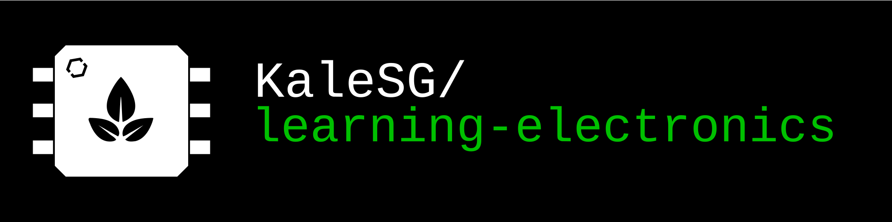

# learning-electronics
Welcome to my learning electronics repository! This is a collection of my hand-picked online resources for learning everything you can about electronics. No matter where you are on your electronics design journey, you can learn **something** about electronics here. This repository contains resources for learning just about anything in electronic design. From the basics of current and voltage, to power electronics and RF engineering, you can find just about anything here. If you can't, and you know of a better resource, please feel free to create a pull request!

## Quick Access To My Favorite Learning Resources

### Resource Sections
* [Beginner Resources](https://github.com/KaleSG/learning-electronics/tree/main#failure-mitigation)
* [Power Systems](https://github.com/KaleSG/learning-electronics/tree/main#power-systems)
* [Analog Systems](https://github.com/KaleSG/learning-electronics/tree/main#power-systems)
* [Embedded Systems](https://github.com/KaleSG/learning-electronics/tree/main#embedded-systems)
* [Failure Mitigation](https://github.com/KaleSG/learning-electronics/tree/main#failure-mitigation)

### Sites
* [ElectronicsTutorials.ws](https://www.electronics-tutorials.ws/) - Pretty much everything about electronics. Great place no matter what you're wanting to learn. Best for both theory and practical knowledge.
* [AllAboutCircuits.com](https://www.allaboutcircuits.com/textbook/) - Very detailed learning resources on electrical theory. Also includes forum resources for anyone interested in talking to more EE people.

### Communities
- [STEM Network Electrical Engineering Discord](https://discord.gg/quFjpsaVvh) - A very friendly, lively community of electrical engineers. Great place to share projects, ideas, questions, concerns, no matter your skill level.
- [r/ElectricalEngineering](https://www.reddit.com/r/ElectricalEngineering/) - Public Reddit Forum full of projects, Q&A, and so much more. 

## Why does this repository exist?
This project originally started off as something I made internally for members on the satellite avionics team on the **Stanford Space Initiative** (SSI) at Stanford University as the Satellite Avionics Co-Lead at the time. The biggest gripe I had about first joining the team is that nobody would help me learn how to get started in electronic design and I was expected to figure it out on my own with no access to resources at all. 

As one of the new satellite avionics leads, I didn't want new members to feel the same way I felt. Like I was stuck behind and everyone somehow knew more than me, and that I was incapable of catching up. So I made an internal repository of resources, which you can see in the [source-documents/](source-documents/) folder. When I had sent it out, people outside of SSI were actually the first ones to reach out about it, not realizing how helpful it actually was.

I am very passionate about education and the accessibility of learning everything and anything one might want to learn. This is my attempt to offer up a resource that anyone can take advantage of. Maybe one day, electrical engineering won't seem so daunting. hopefully.

## Getting Started / Navigating this repository 
This repository is divided up into two major categories:

### **Beginner learning** 
Beginner resources are hand-picked to be easy for those new to electronics. Rather than throwing learners right into a datasheet, these resources take the form of online textbooks and/or video guides about learning basic electrical theory.

However, one thing to note about beginner learning resources is that they are designed to **ease** learners into electronics. This doesn't take away the active learning beginners will need to do on their own. Only for the very introduction to electrical theory will there be video resources supplied on this repository. Learning electronics **properly** is fully dependent on a learners willingness to dive into text resources and go down rabbit holes. Electronics engineering is **impossible** to learn correctly if you are only willing to watch youtube videos, without going into datasheets and software documentation yourself.

### **Intermediate learning**
Intermediate resources cover pretty much everything else that you could ever need to develop any sort of project/product/device you could imagine. It covers everything from power systems, analog circuits, RF/Antenna design, PCB Design/Parasitics, Thermal management, and so much more. 

These resources, of course, are relatively more complicated to navigate, as they are primarily made for engineers who use them in professional products and designs. For example, you can find the full manufacturer specifications for the I2C, SPI, CAN, and UART protocols directly from Texas Instruments. You can also find direct links to Monolithic Power Systems guides on power converters, covering in-depth about how different converter topologies work at the fundamental level. Some of these online resources may look dated, but are chalk full of the most detailed explanations you'll ever find about different systems, like antenna design.

## Beginner Learning Resources

### The VERY Basics
You should understand the topics below before going any further
*Note: I highly suggest using text resources as your primary resource. Videos are good to support learning, but truly understanding doesn't happen until you start fighting with equations and processing information yourself. Passive learning from videos is always advised against.*

* **Basics of Electricity** ([Video Guide](https://youtu.be/mc979OhitAg?si=EriKbMrQTCiKKr52) / [Text Guide](https://www.allaboutcircuits.com/textbook/direct-current/chpt-1/electric-circuits/))

  * **Current** ([Video Guide](https://www.youtube.com/watch?v=kcL2_D33k3o&list=PLWv9VM947MKi_7yJ0_FCfzTBXpQU-Qd3K&index=2) / [Text Guide](https://www.allaboutcircuits.com/textbook/direct-current/chpt-1/electric-circuits/))

  * **Voltage** ([Video Guide](https://www.youtube.com/watch?v=w82aSjLuD_8&list=PLWv9VM947MKi_7yJ0_FCfzTBXpQU-Qd3K&index=3) / [Text Guide](https://www.allaboutcircuits.com/textbook/direct-current/chpt-1/voltage-current/))

  * **Power** ([Video Guide](https://www.youtube.com/watch?v=GPcHFWCvhzg) (jump to 2:25) / [Text Guide](https://learn.sparkfun.com/tutorials/electric-power/all))

  * **Ohm’s Law** ([Video Guide](https://www.youtube.com/watch?v=HsLLq6Rm5tU&list=PLWv9VM947MKi_7yJ0_FCfzTBXpQU-Qd3K&index=4) / [Text Guide](https://www.allaboutcircuits.com/textbook/direct-current/chpt-2/voltage-current-resistance-relate/))

  * **Kirchoff's Laws (**[Video Guide](https://www.youtube.com/watch?v=affa61AME68) / [Text Guide](https://www.allaboutcircuits.com/textbook/direct-current/chpt-6/voltage-divider-circuits/))

  * **Current-Voltage Curves (I-V Curves)** [Video Guide](https://www.youtube.com/watch?v=ZdS6luglLkk) / [Text Guide](https://www.allaboutcircuits.com/technical-articles/understanding-i-v-curves-part-i/)

  * **Series / Parallel Circuits (**[Video Guide](https://www.youtube.com/watch?v=8Z0jhQeYDUE) / [Text Guide](https://www.allaboutcircuits.com/textbook/direct-current/chpt-5/what-are-series-and-parallel-circuits/))

* Understand the following components:

    * **Capacitors** ([Video Guide](https://www.youtube.com/watch?v=X4EUwTwZ110) / [Text Guide](https://www.allaboutcircuits.com/textbook/direct-current/chpt-13/electric-fields-capacitance/))

    * **Inductors** ([Video Guide](https://www.youtube.com/watch?v=KSylo01n5FY) / [Text Guide](https://www.allaboutcircuits.com/textbook/direct-current/chpt-15/magnetic-fields-and-inductance/))

    * **Diodes** ([Video Guide](https://www.youtube.com/watch?v=Fwj_d3uO5g8) / [Text Guide](https://www.allaboutcircuits.com/textbook/semiconductors/chpt-3/introduction-to-diodes-and-rectifiers/))

  
    * **MOSFETs** ([Video Guide](https://www.youtube.com/watch?v=AwRJsze_9m4) / [Text Guide](https://www.allaboutcircuits.com/textbook/semiconductors/chpt-2/insulated-gate-field-effect-transistors-mosfet/))

    * **Metal-Oxide-Semiconductor Field-Effect Transistors**

    * **BJTs** ([Video Guide](https://www.youtube.com/watch?v=J4oO7PT_nzQ) / [Text Guide](https://www.allaboutcircuits.com/textbook/semiconductors/chpt-4/bipolar-junction-transistors-bjt/))

* **Reading Electrical Schematics** (Video Guide / [Text Guide](https://learn.sparkfun.com/tutorials/how-to-read-a-schematic/all))

* **Reading Datasheets**
    * [How-To: Read and Understand Technical Datasheets](https://www.digikey.com/en/maker/tutorials/2024/how-to-read-and-understand-technical-datasheets)

    * [How to Read a Datasheet: Engineer's Step-by-Step Guide \| MicroType](https://www.microtype.io/blog/how-to-read-an-electronics-datasheet)	

* **Learn to use Kicad** ([Getting Started](https://docs.kicad.org/10.0/en/getting_started_in_kicad/getting_started_in_kicad.html) / [Schematics](https://docs.kicad.org/10.0/en/eeschema/eeschema.html) / [PCB Layout](https://docs.kicad.org/10.0/en/pcbnew/pcbnew.html))
    * [Phil's Lab - Intro to KiCad 9 (Part 1/2)](https://www.youtube.com/watch?v=O-zNn5k5Bn4) (Video Series)
    * [Phil's Lab - Intro to KiCad 9 (Part  2/2)](https://www.youtube.com/watch?v=igQWdVGZGpI) (Video Series)

### After The Basics - [Click Here](resources/beginner/after-the-basics.mdw)
This is the part where u actually get to learn about fun stuff! Click the title to access these resources. Below is a list of topics that this section includes.

**Theory and Concepts**

* Electrical Theory Basics (With additional guiding resources)
* Intro to Microcontrollers/Single Board Computers
* Intro to Sensors
* Intro to Actuators (Only Motors, incomplete)
* Intro to Communication Protocols (SPI/I2C/UART)
* Into to Solar Cells + MPPTs
* Intro to Batteries

**Prototyping & Development**
* Intro to Breadboard Prototyping
* Intro to Debugging/Testing/Instrumentation Tools
* Intro to Permanent Prototyping (Soldering, Perfboard, Connector Basics)
* Intro to reading datasheets (repeated)
* Intro to PCB design & Fabrication
* Intro to PCB Schematic & Design Simulation

# Intermediate Learning Resources / Disciplinary Knowledge
If you're an electrical engineering student, advanced hobbyist, or even industry professional, this section isn't something you will want to miss. This list of resources is the fruit of more than 10 hours of my labor to come up with the most comprehensive quick reference of major industry standardizations that include everything from datasheets, design best practices, and system definitions from the ground up.

This reference is by far from entirely comprehensive, however, it is a great place to start if you are aiming to design any sort of electronic system. Originally designed for satellite design, these disciplinary groups give you the knowledge you need to build basically any system you may encounter. (atm its missing info about actuators so if u have some good resources feel free to make a PR).

## Intermediate Resources by Discipline/System

### [Power Systems](/resources/intermediate/power-systems.md)
* DC-DC Converters
* Solar Power Generation
* Battery Systems
* Distribution/Transmission
* Thermal Management/Design

### [Analog Systems](/resources/intermediate/analog-systems.md)
* Signal/Power Filtering & Amplification
* RF & Wireless Systems
* PCB Design & Parasitics
### [Embedded Systems](/resources/intermediate/embedded-systems.md)
* Microcontrollers
* Digital Architecture
* Communication Protocols
* Sensors & Instrumentation
### [Failure Mitigation](/resources/intermediate/failure-mitigation.md)
* Radiation Tolerance / Hardening
* Shock & Vibration Resistant Design